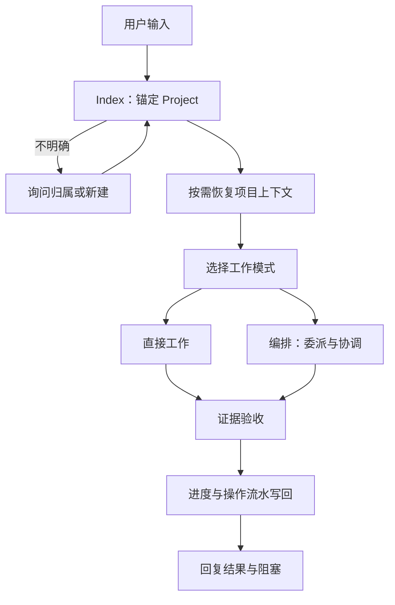

# 总体架构

## 解决的问题

把“临时对话中的任务推进”与“长期项目事实”接起来：知道在做哪个目标、按正确协议执行、检查结果、留下能继续工作的状态，而不是每次重读全部历史或重复解释。

## 六部分与职责

| 部分 | 负责 | 不承担 |
|---|---|---|
| Workspace | 组织入口、协议、能力、项目与产物 | 不把目录结构当执行保障 |
| 全局 Task Harness | 识别本轮任务、选模式、加载协议、验证、收尾 | 不保存独立 Task 生命周期 |
| Project Management | 长期目标、状态、进度、决策、日志和知识 | 不负责所有任务的具体实现 |
| Mode | 对特定工作采用的行为协议 | 不等同 Project 类型或 CodeBuddy 原生模式 |
| Prompt / Subagent | 具体委派契约与独立执行/审查 | 不擅自改共享项目事实 |
| Python / Git | 文件操作一致性、冲突检测、恢复 / 版本同步 | 不代替模型理解，不自动执行外部副作用 |

模式是通用流程中的可变部分；项目归属、上下文、证据、持久化、故障恢复是横跨模式的机制。

## 文件职责

| 路径 | 内容与加载时机 |
|---|---|
| agent.md | 精简强制入口，指引全局协议和独立项目管理 |
| evidence/workflow.md | 每轮执行流程和按需导航 |
| evidence/ | 七种模式，各读所需 |
| evidence/protocols/ | 锚定、恢复、保存、证据、协作、知识、日志、异常 |
| evidence/prompts/ | 委派、独立审查、压缩模板 |
| .codebuddy/agents/ | 官方 Markdown 格式的 worker/reviewer 定义 |
| project-management/README.md | 独立项目管理操作入口 |
| project-management/Index.md | 活跃索引，派生生成 |
| project-management/History.md | 非活跃索引，按需读取 |
| project-management/conventions/ | 用户确认后的公共积累 |
| project-management/projects/状态/类型/ID/ | Project 权威数据 |
| scripts/ | 实际文件操作、安装和演示 |
| tests/ | 行为、并发、恢复、完整性和安装测试 |
| .pm-runtime/ | 本地锁、未完成事务、临时 payload；不入 Git |

## 单个 Project

definition.md：长期问题、期望结果、范围、交付与硬约束。
project.md：机器可读 JSON 代码块，保存稳定 ID、名称、类型、状态、一句话目标、revision 与时间。
state.md：当前进度、未解决问题、下一步。
acceptance.md：目标边界和可验证的完成条件。
decisions.md：提议、确认、失效决定及依据。
notes.md：项目知识；knowledge-candidates.md：公共候选。
source/INDEX.md：资料导航；source 其他文件按需读。
work/：真实工作产物，或登记外部源码仓库路径，避免搬移大型仓库。
logs/current.md：本轮追加的详细流水；summary.md：历史摘要；archive：原始完整流水；receipts.md：防重复交互 ID。

不建立独立的 Task 文件或 Task 数据库；本轮 Task、Mode 和操作证据会作为 Project 日志内容留痕，不充当独立长期对象。

## 一致性与恢复

project.md 是元数据权威，Index/History 是派生视图。脚本单次事务维护项目与索引；进程锁串行化脚本调用，token 阻止旧共享状态写入。原始日志归档带 SHA256。事务意外中断先回滚再继续。

token 不覆盖 work 和普通 source 文件，代码并行由所有权/worktree 隔离。Script 之外的直接文件编辑、跨机器同步不是本地事务的保护范围。

## 接口与可替换性

管理脚本不依赖模型、API Key 或 CodeBuddy 私有接口；可供其他 Agent 调用。CLI 集成只依赖官方 AGENTS.md 适配和 .codebuddy/agents Markdown 定义；agent.md 是本仓库规范入口；没有伪造 Hook 或自动调度 API。未来可替换前端/模型/存储，但当前不扩展软件页面或独立服务。

## 研究与后续演进

此前提及的上下文效率、工作流记忆、长期状态、编排失败等研究方向，可用于后续实验设计。本包具体协议是工程设计，不宣称论文已证明其有效。评价应看归属准确率、无关上下文加载、恢复成功率、写回遵守率和产物验收结果。
